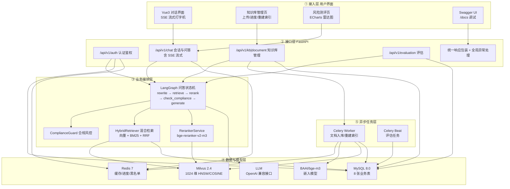
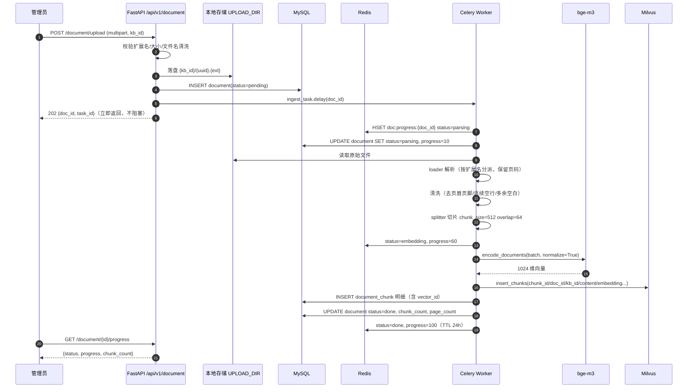
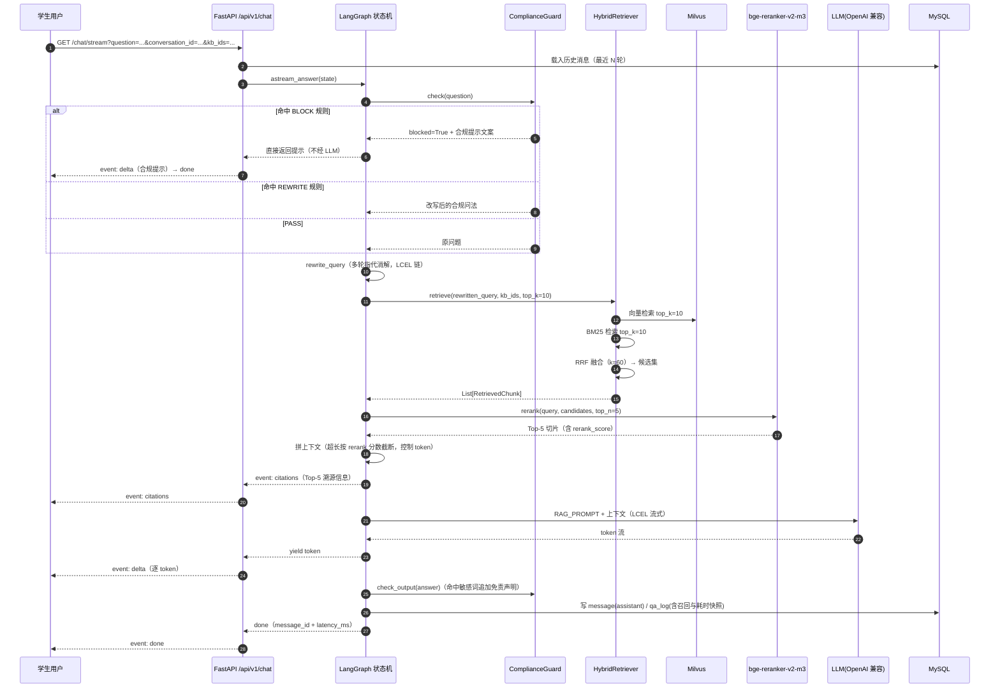
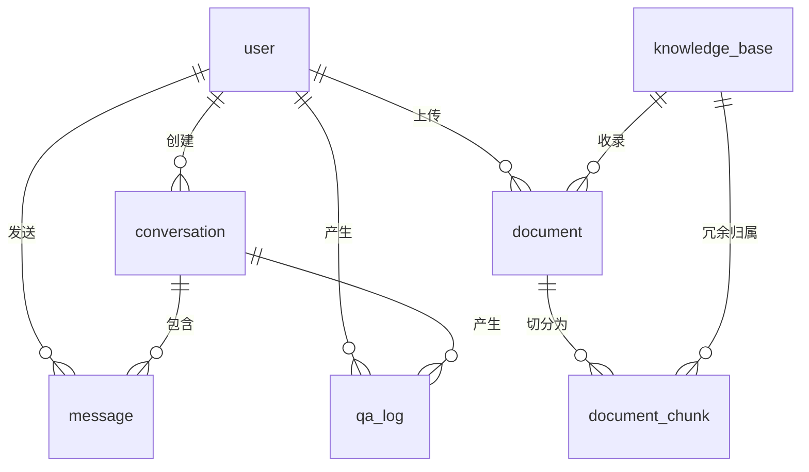

# 大学生理财知识问答系统 · 系统设计文档（DESIGN.md）

> 版本：v1.0　　对应阶段：P1
> 关联文档：`AGENTS.md`（技术栈与编码约束）、`scripts/schema.sql`（建表 DDL）

---

## 1. 系统总体架构

系统采用「离线知识库构建 + 在线检索增强问答」双链路架构，自上而下分为 5 层：



---

## 2. 模块划分与职责表

| 模块 | 目录 | 职责 | 对外接口 |
|---|---|---|---|
| 配置与基础设施 | `app/core/` | 配置加载、日志、异常、JWT 与密码安全、DB 会话、依赖注入 | `get_settings()`、`BizException`、`create_access_token()`、`get_db()`、`get_current_user()` |
| ORM 模型层 | `app/models/` | 8 张业务表的 SQLAlchemy 2.0 声明式映射 | `User`、`Conversation`、`Message`、`KnowledgeBase`、`Document`、`DocumentChunk`、`QaLog`、`RiskRule` |
| 数据校验层 | `app/schemas/` | Pydantic v2 请求/响应模型，统一响应包装 | `ApiResponse[T]`、`ChatRequest`、`LoginRequest` 等 |
| 文档入库流水线 | `app/ingestion/` | 解析（pdf/docx/txt/md/html）→ 清洗 → 切片 → 向量化 → 落库 | `ingest_document(doc_id)`、`load_file()`、`split_documents()`、`encode_documents()` |
| 向量库封装 | `app/vectorstore/` | Milvus 连接、Collection 管理、批量写入、检索、删除 | `MilvusClientWrapper.ensure_collection/insert_chunks/search/delete_by_doc/get_collection_stats` |
| 检索层 | `app/retrieval/` | 向量召回 + BM25 召回 + RRF 融合 + 重排 | `HybridRetriever.retrieve()`、`RerankerService.rerank()` |
| 问答编排 | `app/chains/` | Prompt 模板集中管理、LangGraph 状态机、LCEL 生成链、引用溯源 | `build_qa_graph()`、`astream_answer()` |
| 合规风控 | `app/guard/` | 输入三级动作（BLOCK/REWRITE/PASS）、输出侧敏感词声明 | `ComplianceGuard.check()`、`check_output()` |
| 业务服务层 | `app/services/` | 会话、消息、问答落库、知识库与文档业务逻辑 | `QaService.answer()`、`ConversationService`、`DocumentService` |
| API 层 | `app/api/v1/` | REST 路由、SSE 流式、鉴权依赖、文件上传 | `/api/v1/*` 见第 7 章 |
| 异步任务 | `app/tasks/` | 文档入库、批量重建索引、评估任务 | `ingest_task`、`reindex_kb_task`、`run_eval_task` |
| 评估模块 | `app/evaluation/` | 评测数据集、RAGAS 指标、对比实验脚本 | `ragas_eval.py`、`scripts/experiment_compare.py` |
| 前端 | `web/` | 对话、知识库管理、风险测评、个人中心 | 消费 `/api/v1/*` |

---

## 3. 核心数据流

### 3.1 离线知识库构建流程



失败分支：任一步异常 → `document.status=failed`、写 `error_msg`、Redis 写 `failed`，**异常不上抛**，
由 `GET /document/{id}/progress` 暴露给管理员，可点「重建索引」重试。

### 3.2 在线问答流程



---

## 4. 数据库设计

### 4.1 表结构

通用约定：主键 `id BIGINT UNSIGNED AUTO_INCREMENT`；时间字段统一 `DATETIME(3)`；
所有表含 `created_at` / `updated_at`（`ON UPDATE CURRENT_TIMESTAMP(3)`）；字符集 `utf8mb4`。

#### （1）`user` 用户表

| 字段名 | 类型 | 约束 | 说明 | 索引 |
|---|---|---|---|---|
| id | BIGINT UNSIGNED | PK, AUTO_INCREMENT | 用户 ID | PK |
| username | VARCHAR(64) | NOT NULL | 登录名 | UNIQUE `uk_user_username` |
| email | VARCHAR(128) | NULL | 邮箱 | UNIQUE `uk_user_email` |
| password_hash | VARCHAR(128) | NOT NULL | bcrypt 哈希，禁止明文 | - |
| role | VARCHAR(16) | NOT NULL, DEFAULT 'student' | student / admin | idx `idx_user_role` |
| risk_level | VARCHAR(16) | NULL | C1~C5 风险等级（风险测评结果） | - |
| risk_score | JSON | NULL | 五维得分快照 | - |
| status | TINYINT | NOT NULL, DEFAULT 1 | 1 正常 / 0 禁用 | - |
| last_login_at | DATETIME(3) | NULL | 最近登录时间 | - |
| created_at | DATETIME(3) | NOT NULL, DEFAULT NOW(3) | 创建时间 | - |
| updated_at | DATETIME(3) | NOT NULL, ON UPDATE | 更新时间 | - |

#### （2）`conversation` 会话表

| 字段名 | 类型 | 约束 | 说明 | 索引 |
|---|---|---|---|---|
| id | BIGINT UNSIGNED | PK | 会话 ID | PK |
| user_id | BIGINT UNSIGNED | NOT NULL, FK→user.id | 归属用户 | idx `idx_conv_user(user_id, last_message_at)` |
| title | VARCHAR(128) | NOT NULL, DEFAULT '新会话' | 会话标题（取首问前 30 字） | - |
| kb_ids | JSON | NOT NULL, DEFAULT '[]' | 该会话选定的知识库范围 | - |
| message_count | INT | NOT NULL, DEFAULT 0 | 消息条数 | - |
| last_message_at | DATETIME(3) | NULL | 最近消息时间（列表排序） | 见上组合索引 |
| is_deleted | TINYINT | NOT NULL, DEFAULT 0 | 逻辑删除 | - |
| created_at / updated_at | DATETIME(3) | NOT NULL | 通用时间戳 | - |

#### （3）`message` 消息表

| 字段名 | 类型 | 约束 | 说明 | 索引 |
|---|---|---|---|---|
| id | BIGINT UNSIGNED | PK | 消息 ID | PK |
| conversation_id | BIGINT UNSIGNED | NOT NULL, FK→conversation.id | 会话 | idx `idx_msg_conv(conversation_id, id)` |
| user_id | BIGINT UNSIGNED | NOT NULL, FK→user.id | 归属用户 | - |
| role | VARCHAR(16) | NOT NULL | user / assistant | - |
| content | TEXT | NOT NULL | 消息正文（Markdown） | - |
| citations | JSON | NULL | 引用列表 `[{index,doc_name,page_no,snippet,score}]` | - |
| retrieved_chunks | JSON | NULL | 检索切片快照（可复现性） | - |
| latency_ms | INT | NULL | 端到端耗时 | - |
| token_usage | INT | NULL | 生成 token 数 | - |
| blocked | TINYINT | NOT NULL, DEFAULT 0 | 是否被风控拦截 | - |
| feedback | TINYINT | NULL | 1 点赞 / -1 点踩 | - |
| created_at / updated_at | DATETIME(3) | NOT NULL | 通用时间戳 | - |

#### （4）`knowledge_base` 知识库表

| 字段名 | 类型 | 约束 | 说明 | 索引 |
|---|---|---|---|---|
| id | BIGINT UNSIGNED | PK | 知识库 ID | PK |
| name | VARCHAR(128) | NOT NULL | 名称 | UNIQUE `uk_kb_name` |
| description | VARCHAR(512) | NULL | 描述 | - |
| category | VARCHAR(64) | NOT NULL | 储蓄/基金/股票/保险/信用/反诈 | idx `idx_kb_category` |
| owner_id | BIGINT UNSIGNED | NULL, FK→user.id | 创建者 | - |
| doc_count | INT | NOT NULL, DEFAULT 0 | 文档数（冗余统计） | - |
| chunk_count | INT | NOT NULL, DEFAULT 0 | 切片数（冗余统计） | - |
| status | TINYINT | NOT NULL, DEFAULT 1 | 1 启用 / 0 停用 | - |
| created_at / updated_at | DATETIME(3) | NOT NULL | 通用时间戳 | - |

#### （5）`document` 文档表

| 字段名 | 类型 | 约束 | 说明 | 索引 |
|---|---|---|---|---|
| id | BIGINT UNSIGNED | PK | 文档 ID | PK |
| kb_id | BIGINT UNSIGNED | NOT NULL, FK→knowledge_base.id | 所属知识库 | idx `idx_doc_kb(kb_id, status)` |
| name | VARCHAR(255) | NOT NULL | 原始文件名 | - |
| file_path | VARCHAR(512) | NOT NULL | 落盘相对路径 | - |
| file_type | VARCHAR(16) | NOT NULL | pdf/docx/txt/md/html | - |
| file_size | BIGINT | NOT NULL, DEFAULT 0 | 字节数 | - |
| checksum | VARCHAR(64) | NULL | MD5，用于幂等去重 | UNIQUE `uk_doc_kb_checksum(kb_id, checksum)` |
| status | VARCHAR(16) | NOT NULL, DEFAULT 'pending' | pending/parsing/splitting/embedding/done/failed | 见上组合索引 |
| progress | INT | NOT NULL, DEFAULT 0 | 0~100 | - |
| page_count | INT | NOT NULL, DEFAULT 0 | 解析页数 | - |
| chunk_count | INT | NOT NULL, DEFAULT 0 | 切片数 | - |
| error_msg | VARCHAR(1024) | NULL | 失败原因 | - |
| uploaded_by | BIGINT UNSIGNED | NULL, FK→user.id | 上传人 | - |
| created_at / updated_at | DATETIME(3) | NOT NULL | 通用时间戳 | - |

#### （6）`document_chunk` 文档切片表

| 字段名 | 类型 | 约束 | 说明 | 索引 |
|---|---|---|---|---|
| id | BIGINT UNSIGNED | PK | 切片 ID（业务主键） | PK |
| doc_id | BIGINT UNSIGNED | NOT NULL, FK→document.id | 所属文档 | idx `idx_chunk_doc(doc_id)` |
| kb_id | BIGINT UNSIGNED | NOT NULL, FK→knowledge_base.id | 冗余知识库（过滤用） | idx `idx_chunk_kb(kb_id)` |
| chunk_index | INT | NOT NULL | 文档内序号 | - |
| content | MEDIUMTEXT | NOT NULL | 切片原文（溯源展示） | - |
| char_count | INT | NOT NULL, DEFAULT 0 | 字符数 | - |
| page_no | INT | NOT NULL, DEFAULT 0 | 页码 | - |
| vector_id | BIGINT UNSIGNED | NULL | Milvus 主键（= 本表 id） | - |
| category | VARCHAR(64) | NULL | 分类 | - |
| risk_level | VARCHAR(16) | NOT NULL, DEFAULT 'low' | low/medium/high（内容敏感度） | - |
| created_at / updated_at | DATETIME(3) | NOT NULL | 通用时间戳 | - |

#### （7）`qa_log` 问答日志表（论文实验数据来源）

| 字段名 | 类型 | 约束 | 说明 | 索引 |
|---|---|---|---|---|
| id | BIGINT UNSIGNED | PK | 日志 ID | PK |
| user_id | BIGINT UNSIGNED | NOT NULL | 用户 | idx `idx_qa_user_time(user_id, created_at)` |
| conversation_id | BIGINT UNSIGNED | NULL | 会话 | - |
| message_id | BIGINT UNSIGNED | NULL | 助手消息 ID | - |
| question | TEXT | NOT NULL | 原始问题 | - |
| rewritten_query | TEXT | NULL | 改写后查询 | - |
| answer | TEXT | NULL | 最终答案 | - |
| strategy | VARCHAR(32) | NOT NULL, DEFAULT 'hybrid_rerank' | vector/bm25/hybrid/hybrid_rerank（对比实验维度） | idx `idx_qa_strategy` |
| guard_action | VARCHAR(16) | NOT NULL, DEFAULT 'PASS' | BLOCK/REWRITE/PASS | - |
| retrieved_chunks | JSON | NULL | 召回切片快照 | - |
| citations | JSON | NULL | 引用列表 | - |
| recall_count | INT | NULL | 融合前候选数 | - |
| fused_count | INT | NULL | RRF 融合后数量 | - |
| rerank_count | INT | NULL | 重排后数量 | - |
| retrieve_ms | INT | NULL | 检索耗时 | - |
| rerank_ms | INT | NULL | 重排耗时 | - |
| generate_ms | INT | NULL | 生成耗时 | - |
| latency_ms | INT | NULL | 端到端耗时 | - |
| prompt_tokens / completion_tokens | INT | NULL | token 用量 | - |
| created_at / updated_at | DATETIME(3) | NOT NULL | 通用时间戳 | - |

#### （8）`risk_rule` 风控规则表

| 字段名 | 类型 | 约束 | 说明 | 索引 |
|---|---|---|---|---|
| id | BIGINT UNSIGNED | PK | 规则 ID | PK |
| rule_code | VARCHAR(32) | NOT NULL | 规则编码 | UNIQUE `uk_rule_code` |
| name | VARCHAR(128) | NOT NULL | 规则名称 | - |
| pattern | VARCHAR(512) | NOT NULL | 正则表达式 | - |
| action | VARCHAR(16) | NOT NULL | BLOCK / REWRITE / WARN | idx `idx_rule_enabled_action(enabled, action, priority)` |
| category | VARCHAR(32) | NOT NULL | 荐股/保收益/诱导交易/反诈 | - |
| replacement | VARCHAR(255) | NULL | REWRITE 动作的合规改写模板 | - |
| priority | INT | NOT NULL, DEFAULT 100 | 数值越小优先级越高 | 见上组合索引 |
| enabled | TINYINT | NOT NULL, DEFAULT 1 | 启用开关 | 见上组合索引 |
| hit_count | INT | NOT NULL, DEFAULT 0 | 命中次数（运营观测） | - |
| remark | VARCHAR(512) | NULL | 备注 | - |
| created_at / updated_at | DATETIME(3) | NOT NULL | 通用时间戳 | - |

完整建表 SQL 见 `scripts/schema.sql`。

### 4.2 ER 关系概览



---

## 5. Milvus Collection 设计

Collection 名：`finance_chunks`（单 Collection + `kb_id` 标量过滤，避免多集合跨库检索复杂度）。

### 5.1 Schema 字段

| 字段名 | 类型 | 说明 | 备注 |
|---|---|---|---|
| chunk_id | Int64 | 主键 | `auto_id=False`，与 MySQL `document_chunk.id` 一致，保证双侧可对账 |
| doc_id | Int64 | 文档 ID | 标量过滤 / 级联删除 |
| kb_id | Int64 | 知识库 ID | 标量过滤（检索范围控制） |
| content | VarChar(8192) | 切片原文 | 与 MySQL 冗余存储，检索后可直接拼上下文 |
| category | VarChar(64) | 分类 | 储蓄/基金/股票/保险/信用/反诈 |
| source | VarChar(256) | 来源文件名 | 溯源展示 |
| page | Int32 | 页码 | 溯源展示 |
| risk_level | VarChar(16) | 内容敏感等级 | low/medium/high |
| embedding | FloatVector(1024) | bge-m3 稠密向量 | 归一化后写入 |

### 5.2 索引与度量

| 项 | 取值 | 理由 |
|---|---|---|
| 索引类型 | HNSW | 图索引，高召回高吞吐，适合十万级切片 |
| 索引参数 | `M=16`、`efConstruction=200` | M 控制图的连通度，16 在召回与内存间平衡；efConstruction=200 保证建图质量 |
| 度量方式 | COSINE | 中文语义检索中文档长度差异大，余弦对长度不敏感；向量已归一化 |
| 检索参数 | `ef=64` | 查询期精度/延迟折中（可调 32~128） |
| 召回 top_k | 10 | 满足重排输入规模，同时控制延迟 |
| 重排后入 prompt | Top-5 | 上下文 token 与精度折中 |
| 标量过滤 | `kb_id in [...] && category == "..."` | 由 `expr` 表达式下发 |

### 5.3 一致性策略

- **写入顺序**：先写 MySQL `document_chunk`（拿到自增 id）→ 以该 id 作为 `chunk_id` 写 Milvus → 回写 `vector_id`。
- **删除**：删文档时先 `delete_by_doc(doc_id)` 清向量，再删 MySQL 明细（保证不残留孤儿向量）。
- **重建**：`reindex_kb_task(kb_id)` 先按 `doc_id` 删除旧向量，再逐文档重跑入库流水线（幂等）。

---

## 6. Redis Key 命名规范

统一前缀 `finance:`，冒号分层，`{}` 内为变量。

| Key 模式 | 类型 | TTL | 用途 |
|---|---|---|---|
| `finance:jwt:blacklist:{jti}` | String | 与 token 剩余有效期一致 | 登出后 token 失效黑名单 |
| `finance:riskrule:cache` | String(JSON) | 300s | 风控规则缓存（DB 变更 5 分钟内生效） |
| `finance:doc:progress:{doc_id}` | Hash(`status`,`progress`,`msg`,`updated_at`) | 86400s | 文档入库进度查询 |
| `finance:kb:bm25:version:{kb_id}` | String(INT) | 无（常驻） | BM25 索引版本号，文档变更时 INCR 触发本地缓存重建 |
| `finance:cache:answer:{md5(query|kb_ids|strategy)}` | String(JSON) | 3600s | 高频问题答案缓存（可选开关 `ENABLE_ANSWER_CACHE`） |
| `finance:ratelimit:qa:{user_id}:{yyyymmddHHMM}` | String(INT) | 60s | 问答接口限流计数 |
| `finance:task:{task_id}` | String(JSON) | 86400s | Celery 任务状态快照（便于前端轮询） |
| `finance:stats:qa:{yyyy-mm-dd}` | Hash | 90 天 | 每日问答量、拦截量统计（管理端图表） |
| `finance:eval:progress:{run_id}` | Hash | 604800s | 评估任务进度（可中断续跑） |

---

## 7. REST API 契约表

统一约定：

- 前缀 `/api/v1`；响应统一包装 `{"code": 0, "message": "ok", "data": {...}}`，`code != 0` 表示业务错误（配合 HTTP 状态码）。
- 鉴权：除注册/登录/健康检查外，均需请求头 `Authorization: Bearer <JWT>`；标注「管理员」的接口还需 `role=admin`。
- 时间字段为 ISO8601（毫秒精度）。

| 方法 | 路径 | 请求体 | 响应体 data | 鉴权 | 说明 |
|---|---|---|---|---|---|
| GET | `/health` | - | `{status, version, milvus, mysql, redis}` | 无 | 健康检查（含依赖探活） |
| POST | `/auth/register` | `{username, password, email?}` | `{user_id, username, role}` | 无 | 注册（默认 student） |
| POST | `/auth/login` | `{username, password}` | `{access_token, token_type, expires_in, user}` | 无 | 登录签发 JWT |
| GET | `/auth/me` | - | `{id, username, role, risk_level, created_at}` | 用户 | 当前用户信息 |
| PUT | `/auth/risk-profile` | `{answers: int[10]}` | `{risk_level, risk_score{...}, suggestion}` | 用户 | 提交风险测评，写回 user 表 |
| POST | `/chat/conversations` | `{title?, kb_ids?: int[]}` | `{id, title, kb_ids, created_at}` | 用户 | 新建会话 |
| GET | `/chat/conversations` | query: `page,size` | `{total, page, size, items[]}` | 用户 | 会话列表（分页） |
| PATCH | `/chat/conversations/{id}` | `{title?, kb_ids?}` | `{id, title, kb_ids}` | 用户 | 重命名 / 切换知识库范围 |
| DELETE | `/chat/conversations/{id}` | - | `{id}` | 用户 | 逻辑删除会话 |
| GET | `/chat/conversations/{id}/messages` | query: `page,size` | `{total, items:[{id,role,content,citations,created_at}]}` | 用户 | 历史消息 |
| POST | `/chat/completions` | `{question, conversation_id?, kb_ids?, strategy?, stream=false}` | `{message_id, answer, citations[], qa_log_id, latency_ms}` | 用户 | 非流式问答 |
| GET | `/chat/stream` | query: `question, conversation_id?, kb_ids?, strategy?` | SSE：`citations` / `delta` / `done` / `error` | 用户 | 流式问答（`text/event-stream`） |
| POST | `/chat/messages/{id}/feedback` | `{feedback: 1\|-1}` | `{message_id, feedback}` | 用户 | 点赞/点踩 |
| GET | `/kb` | query: `page,size,keyword?` | `{total, items[]}` | 用户 | 知识库列表（供多选） |
| POST | `/kb` | `{name, description?, category}` | `{id, name, category}` | 管理员 | 新建知识库 |
| PATCH | `/kb/{id}` | `{name?, description?, status?}` | `{id, ...}` | 管理员 | 修改知识库 |
| DELETE | `/kb/{id}` | - | `{id}` | 管理员 | 删除（含文档与向量级联清理） |
| POST | `/document/upload` | multipart: `file, kb_id` | `{doc_id, task_id, status}` | 管理员 | 上传并投递异步入库 |
| GET | `/document` | query: `kb_id?, status?, page,size` | `{total, items[]}` | 管理员 | 文档列表 |
| GET | `/document/{id}/progress` | - | `{status, progress, chunk_count, error_msg}` | 管理员 | 入库进度 |
| POST | `/document/{id}/reindex` | - | `{doc_id, task_id}` | 管理员 | 单文档重建索引 |
| POST | `/document/reindex?kb_id=` | - | `{kb_id, task_id}` | 管理员 | 整库重建索引 |
| DELETE | `/document/{id}` | - | `{doc_id}` | 管理员 | 删除文档（DB + 向量 + 文件） |
| POST | `/evaluation/run` | `{dataset?, limit?, strategies?: str[]}` | `{run_id, status}` | 管理员 | 触发评估任务 |
| GET | `/evaluation/{run_id}` | - | `{run_id, status, progress, report_path}` | 管理员 | 查询评估报告 |
| GET | `/evaluation/report` | query: `run_id?` | `{rows:[{config, faithfulness, answer_relevancy, context_precision, context_recall, avg_latency_ms}]}` | 管理员 | 读取 CSV 结果供前端画图 |

### 7.1 SSE 事件格式

```
event: citations
data: {"citations":[{"index":1,"doc_name":"基金投资基础.pdf","page_no":3,"snippet":"...","score":0.83}]}

event: delta
data: {"text":"基金定投是指"}

event: done
data: {"message_id":128,"latency_ms":4210,"guard_action":"PASS"}
```

响应头：`Content-Type: text/event-stream`、`Cache-Control: no-cache`、`X-Accel-Buffering: no`。

---

## 8. 关键设计决策与理由

| # | 决策点 | 方案 | 备选方案 | 选择理由 |
|---|---|---|---|---|
| 1 | 检索范式 | 向量 + BM25 混合 + RRF 融合 + 重排（bge-reranker-v2-m3） | ①纯向量检索　②纯 BM25　③加权求和融合 | 金融领域存在大量精确术语与数字（「七日年化」「存款保险 50 万」），纯向量对专有名词/数字不敏感；BM25 补精确匹配。RRF 基于排名融合，无需调权重、对不同分数量纲鲁棒，工程上更稳；重排用交叉编码器对 (query, chunk) 精算相关性，解决双塔向量召回粗排的精度损失。P12 用 A/B/C/D 四组对比实验量化收益与延迟代价。 |
| 2 | 编排框架 | LangGraph 有向状态图 | ①LangChain 顺序 Chain　②手写 if-else 流程 | 问答流程存在**条件分支**（风控命中直接短路、检索为空降级），顺序 Chain 无法优雅表达；LangGraph 显式状态（TypedDict）+ 节点化，便于单元测试与流程图进论文；同时天然支持 `astream` 流式。 |
| 3 | 向量库选型 | Milvus 2.4 单 Collection + 标量过滤 | ①每知识库一个 Collection　②Chroma/FAISS 本地索引 | 多集合检索需多次查询再归并，且无法全局去重；单集合 + `kb_id` 过滤一次查询解决，扩容与运维简单。Milvus 支持持久化、HNSW 索引、标量过滤，优于 FAISS（无服务化、无标量过滤）与 Chroma（大规模性能弱）。 |
| 4 | 向量维度与模型 | bge-m3，1024 维，本地 sentence-transformers | ①OpenAI text-embedding-3　②bge-small 512 维 | bge-m3 中文语义检索效果好、支持长文本（8192），本地推理零 API 成本、可离线复现实验；1024 维在精度与存储/检索延迟间平衡（相对 768 维提升召回，相对 4096 维节省内存）。 |
| 5 | 长耗时任务 | Celery + Redis 异步，接口 202 立即返回 | ①同步处理　②FastAPI BackgroundTasks | 文档解析 + 向量化动辄数十秒，同步会占满事件循环并触发网关超时；BackgroundTasks 无重试/无横向扩容/无进度查询。Celery 支持重试退避、进度写 Redis、独立 worker 扩容。 |
| 6 | 幻觉控制 | 强约束 Prompt + 引用编号 + 「知识库中未收录」兜底 + 检索分数阈值 | ①仅靠温度参数　②后置人工审核 | 只需要求模型「仅依据资料回答」仍可能自由发挥，必须同时提供编号引用（可追溯）与无资料时的显式兜底话术；再叠加输出侧合规检查，形成可验证的三层防线，且便于写出测试用例。 |
| 7 | 合规风控 | 规则库（DB 驱动）+ 三级动作 BLOCK/REWRITE/PASS + 输出侧声明 | ①仅 Prompt 声明免责　②纯关键词黑名单 | 金融问答涉及荐股、保收益等合规红线，需**确定性**拦截而非依赖模型自觉；规则入库可运营调整（5 分钟缓存热更新）；REWRITE 在守住合规的同时尽量保留用户学习价值（把「买哪只基金」转为「如何评估一只基金」）。 |
| 8 | 数据库 | MySQL 8.0 + SQLAlchemy 2.0 async；不用 Alembic | ①PostgreSQL　②MongoDB　③Alembic 迁移 | 业务数据强关系（用户-会话-消息-文档-切片），关系库最合适；毕设规模用 `create_all` + `init_db.py` 更简单可复现，迁移工具收益低。 |
| 9 | 引用溯源粒度 | 切片级（chunk）+ 页码 + 文件名 + 分数 | ①文档级　②段落级人工标注 | 切片级是 RAG 的最小可信单元，页码与文件名足以让用户回查原文；文档级太粗（用户仍需自行定位），段落级需额外标注成本且无标准。 |
| 10 | 缓存策略 | 仅缓存风控规则、BM25 索引版本、文档进度；答案缓存默认关闭 | 缓存 RAG 答案 | 答案缓存会掩盖实验数据、且易返回过期合规文本；对论文实验（延迟、指标）有害。故只缓存确定性、低风险对象，保证实验可复现。 |

---

## 9. 章节大纲

1. 系统总体架构（分层架构图 + 部署视图）
2. 模块划分与职责表
3. 核心数据流（离线入库时序图 / 在线问答时序图）
4. 数据库设计（8 张表字段表 + ER 图 + `scripts/schema.sql`）
5. Milvus Collection 设计（字段 / 索引 / 度量 / 一致性策略）
6. Redis Key 命名规范表
7. REST API 契约表（含 SSE 事件格式）
8. 关键设计决策与理由（10 条「方案 / 备选 / 理由」）
9. 非功能设计（性能、安全、可测试性、可扩展性）

## 10. 非功能设计要点

| 维度 | 设计 |
|---|---|
| 性能 | 检索全异步；嵌入与重排用 `asyncio.to_thread` 包装同步推理；Milvus HNSW `ef=64`；目标 P95 端到端 < 8s（不含模型冷启动） |
| 安全 | bcrypt 密码哈希、JWT（HS256，可配过期）、文件名清洗防路径穿越、上传类型与大小白名单（≤20MB）、SQL 全参数化（ORM） |
| 可测试性 | 外部依赖（Milvus / LLM / 嵌入 / 重排）全部可注入替换；单测覆盖 RRF 排序、风控 15+ 用例、LangGraph 三分支 |
| 可扩展性 | 单 Collection + 标量过滤支持横向增加知识库；Celery worker 可水平扩容；重排模型与 LLM 均为可替换适配层 |
| 可观测性 | 结构化日志（含 `trace_id`）+ `qa_log` 全链路耗时（recall/rerank/generate）落库，供论文实验与前端统计 |
| 合规 | 三层防线：输入侧拦截 → Prompt 约束 → 输出侧声明；全站固定免责声明常量 `DISCLAIMER` |
