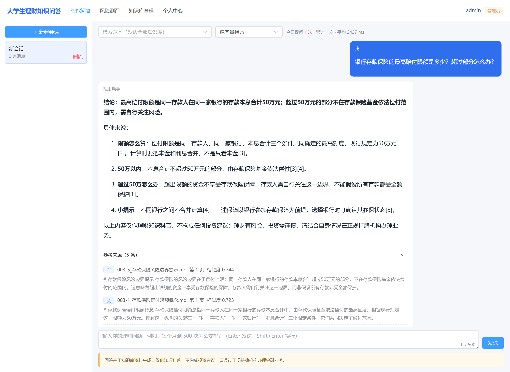
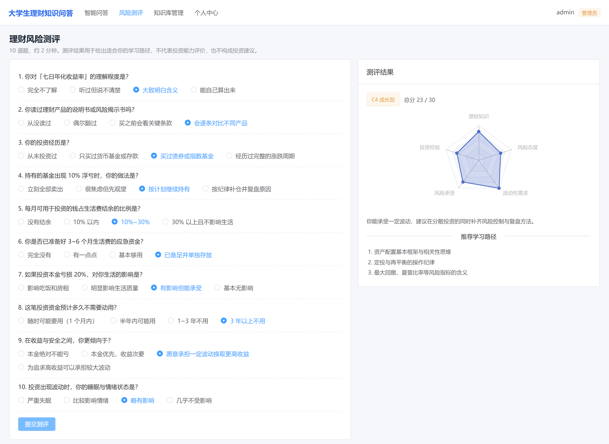
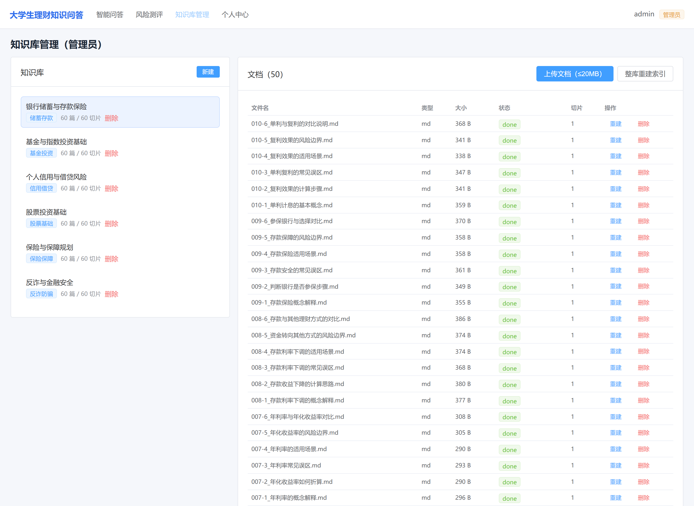
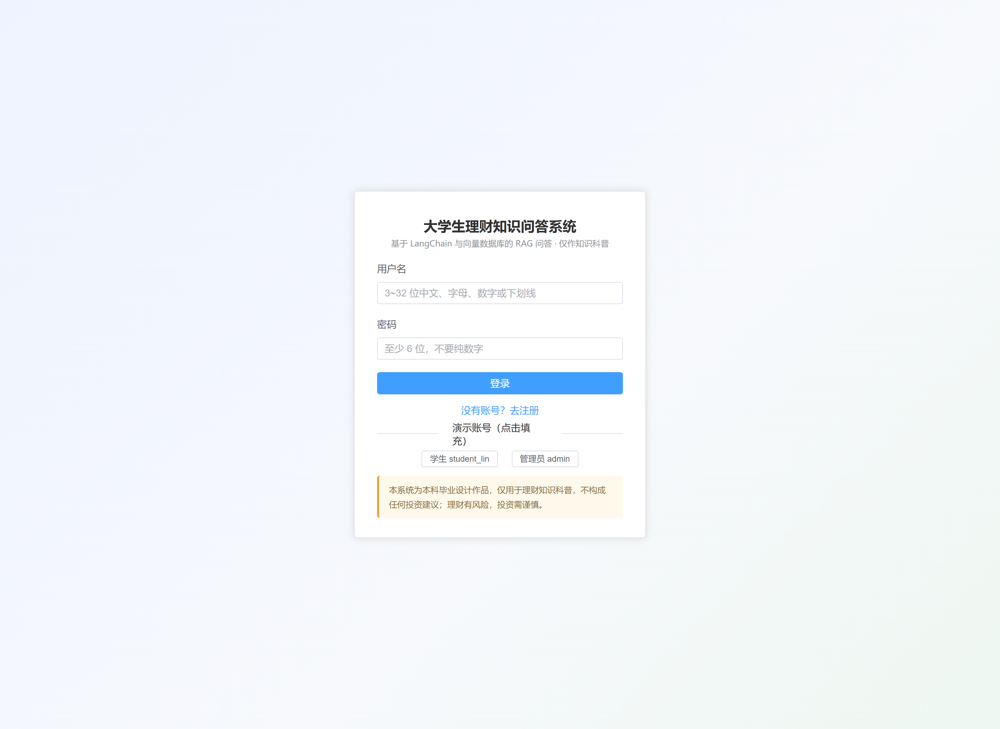
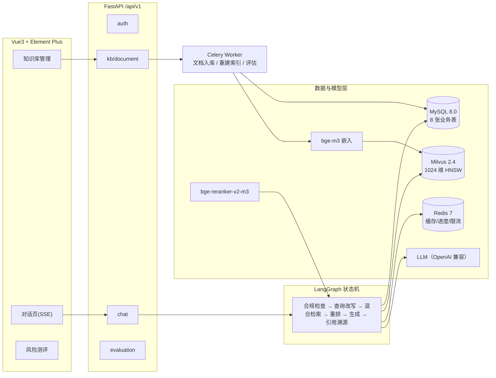
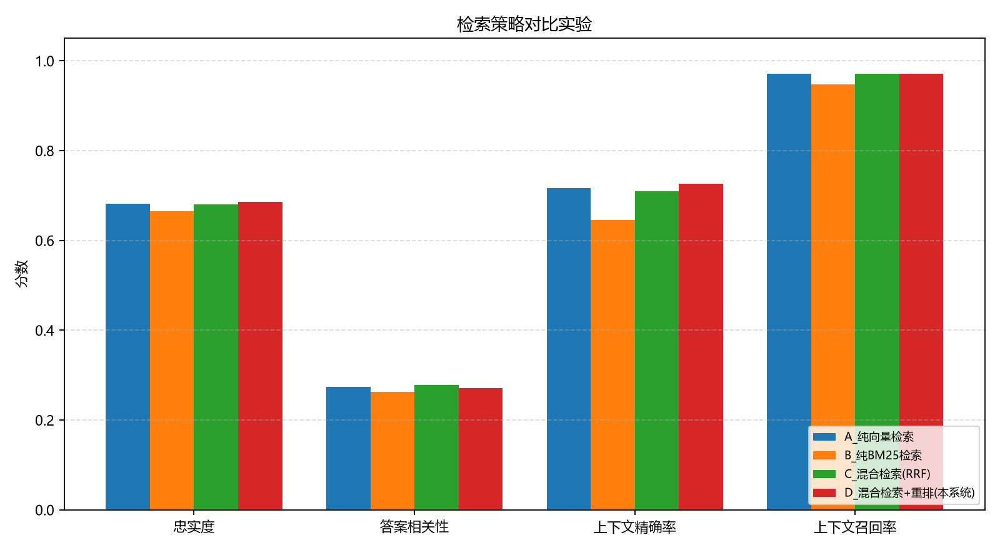

# 基于 LangChain 与向量数据库的大学生理财知识问答系统

> 本科毕业设计项目。面向在校大学生的理财知识问答 Web 系统，采用 **RAG（检索增强生成）** 架构：
> 答案必须可溯源到知识库原文，系统只做知识科普，**不构成任何投资建议**。

---

## 一、项目简介

大学生理财需求正在快速增长，但网络信息良莠不齐：既存在承诺收益、荐股荐基等违规内容，
也缺少贴合学生场景（每月结余几百元怎么开始、校园贷有什么坑）的权威解释。
本系统把「权威理财知识文档」做成可检索的向量知识库，用户提问时先检索、再生成，
并给出**引用来源（文件名 + 页码 + 原文片段）**，同时用规则引擎挡住投资建议类问题。

核心特性：

| 特性 | 说明 |
|---|---|
| 混合检索 | 向量召回（bge-m3 + Milvus HNSW/COSINE）与 BM25 关键词召回并行，RRF 融合 |
| 交叉编码器重排 | bge-reranker-v2-m3 对 Top-N 候选精排，再取 Top-5 进 prompt |
| 多轮问答 | LangGraph 状态机：查询改写 → 检索 → 重排 → 合规 → 生成 → 引用溯源 |
| 引用溯源 | 每条答案返回 `[1][2]` 编号与文件名/页码/片段/分数，可回查原文 |
| 合规风控 | 规则库三级动作（BLOCK / REWRITE / PASS）+ 输出侧敏感表述兜底声明 |
| 全异步 + 异步任务 | FastAPI 全异步；文档解析与向量化走 Celery，接口立即返回并轮询进度 |
| 评估体系 | 60 条评测集 + A/B/C/D 四组检索配置对比实验，自动产出 CSV 与柱状图 |

## 二、功能模块

| 页面 | 主要功能 |
|---|---|
| 对话主界面 | SSE 流式输出、参考来源折叠区（文件名 + 页码 + 原文片段）、点赞 / 点踩反馈 |
| 知识库管理 | 文档上传、入库进度、删除与重建索引 |
| 风险测评 | 10 题问卷 → 五维雷达图 → 风险等级与学习路径推荐 |
| 评估对比 | A/B/C/D 四组检索策略指标对比，自动产出 CSV 与柱状图 |

检索策略对比实验的可视化结果可直接查看：

- `app/evaluation/results/compare_offline_20261014_112359_full60.png`（四组配置指标柱状图）
- `app/evaluation/results/compare_service_20261019_220621_c360all.csv`（360 卡片 / 60 样本明细）

### 界面预览

> 以下截图取自实际运行的演示环境（2 核 4GB 云服务器 + `docker-compose.lite.yml`，
> 库内 6 个知识库 / 360 篇文档 / 360 条切片），非设计稿。

**对话主界面**：一次完整问答——检索 → 生成 → `[1][2]` 引用编号 → 可展开的原文来源
（文件名 + 页码 + 片段 + 相似度），底部固定风险提示。该次请求端到端 2.4s。



**风险测评**：10 题问卷提交后即时计算五维得分（理财知识 / 风险态度 / 流动性需求 /
风险承受 / 投资经验），输出 C1–C5 风险等级与推荐学习路径。



**知识库管理（管理员）**：按知识库分组管理文档，展示入库状态 `done`、切片数与重建索引入口。



**登录页**：JWT 登录，内置学生 / 管理员演示账号一键填充。



## 三、系统架构



### 轻量部署模式（2 核 4GB 可运行）

完整设计含 8 个服务，实测需约 8GB 内存。为在低配云服务器上交付演示环境，仓库额外提供
`docker-compose.lite.yml`，把组件压缩至 **3 个容器**（redis / app / nginx），实测常驻内存
**1.6GB**、稳态问答延迟 **2.1s**：

| 原组件 | 精简方案 | 收益 |
|---|---|---|
| Milvus 2.4 + etcd + MinIO | **Milvus Lite**（`MILVUS_LITE_PATH`，单文件嵌入式） | 少 3 个容器，省约 1.8GB |
| MySQL 8.0 | **SQLite**（`sqlite+aiosqlite`） | 少 1 个容器；模型层已有 `with_variant(Integer, "sqlite")`，业务代码零改动 |
| Celery Worker | **`INLINE_INGEST=true`** | 入库在 API 进程内异步执行，省一份嵌入模型 |
| `uvicorn --workers 2` | **`UVICORN_WORKERS=1`** | 双 worker 会加载两份 bge-m3，是原设计最隐蔽的内存开销 |

```bash
docker compose -f docker-compose.lite.yml up -d --build
```

> Milvus Lite 为单进程独占数据库文件：批量入库须先停掉 app，再以独立容器执行
> `docker compose -f docker-compose.lite.yml run --rm --no-deps app python scripts/ingest_corpus.py --cards data/corpus/cards.jsonl`。

详细设计（含 8 张表字段表、Milvus Collection 设计、Redis Key 规范、REST 契约、设计决策）见
[DESIGN.md](DESIGN.md)。

## 四、快速开始

### 方式一：Docker 一键启动（推荐用于演示与答辩）

```bash
cp .env.example .env          # 按需修改密码与 LLM_API_KEY
mkdir -p models               # 放本地模型（见下方“模型下载”）
docker compose up -d --build
docker compose exec app python scripts/init_db.py      # 建表
docker compose exec app python scripts/seed_data.py    # 种子数据
```

或直接运行一键脚本：`bash scripts/quickstart.sh`（Windows：`powershell -ExecutionPolicy Bypass -File scripts\quickstart.ps1`）。

访问：前端 `http://localhost/`　接口文档 `http://localhost/docs`　健康检查 `http://localhost/health`

> 阿里云 ECS 部署见 [deploy/DEPLOY_ALIYUN.md](deploy/DEPLOY_ALIYUN.md)，
> 一键脚本 `sudo bash deploy/aliyun_deploy.sh --with-models --with-corpus`。

默认账号：`admin / Admin@2026`（管理员）、`student_lin / Student@2026`（学生）。

### 方式二：本地开发（不依赖 Docker）

```bash
python -m venv .venv && .venv\Scripts\activate      # Windows
pip install -r requirements.txt
cp .env.example .env                                 # 改为本地 MySQL/Redis 地址
python scripts/init_db.py && python scripts/seed_data.py
uvicorn app.main:app --reload --port 8000

# 另开一个终端启动异步任务 worker
celery -A app.tasks.celery_app:celery_app worker -Q finance_qa -l info -P solo   # Windows
celery -A app.tasks.celery_app:celery_app worker -Q finance_qa -l info -c 4      # Linux
```

### 方式三：无 Docker 的本地联调（MariaDB + Milvus Lite + 本地小模型）

适合没有 Docker/WSL 的 Windows 机器做端到端验证：

```bash
# 1) 启动便携 MariaDB（首次需先 mariadb-install-db，见 work_logs/mariadb）
work_logs\mariadb\mariadb-11.4.2-winx64\bin\mysqld.exe --datadir=work_logs\mariadb\data --port=3307

# 2) 启动本地 OpenAI 兼容模型服务（需先下载 models/qwen2.5-0.5b-instruct）
python scripts/local_llm_server.py --model models/qwen2.5-0.5b-instruct --port 11435

# 3) 一键联调：建表 → 种子 → 上传 3 篇文档 → 入库 → 问答 → SSE → 生成报告
python scripts/e2e_local.py
```

该模式使用 `MILVUS_LITE_PATH`（嵌入式 Milvus）与 `INLINE_INGEST=true`（进程内异步入库），
仅用于开发/答辩演示；生产部署仍使用 MySQL + Milvus 服务端 + Redis + Celery。

### 模型下载（嵌入与重排）

模型体积大，**不打进镜像**，统一放在 `./models`（容器内挂载为 `/models`）：

```bash
# HuggingFace
huggingface-cli download BAAI/bge-m3              --local-dir models/bge-m3
huggingface-cli download BAAI/bge-reranker-v2-m3  --local-dir models/bge-reranker-v2-m3

# 或 ModelScope（国内网络更快）
modelscope download --model BAAI/bge-m3             --local_dir models/bge-m3
modelscope download --model BAAI/bge-reranker-v2-m3 --local_dir models/bge-reranker-v2-m3
```

本地推理还需要安装：`pip install torch sentence-transformers`（未安装时入库与重排会给出明确错误提示）。

## 五、目录说明

```
finance-qa/
├─ AGENTS.md                # 项目约束（技术栈、编码规范、禁止事项）
├─ DESIGN.md                # 系统设计文档（架构/表设计/Milvus/API 契约/设计决策）
├─ docker-compose.yml       # 一键编排：mysql/redis/etcd/minio/milvus/app/worker/nginx
├─ Dockerfile · nginx.conf  # 应用镜像与反向代理（含 SSE 专用配置）
├─ requirements.txt         # 依赖（版本已锁定）
├─ app/
│  ├─ main.py               # FastAPI 入口（异常处理、trace_id、健康检查）
│  ├─ core/                 # 配置 / 日志 / 异常 / 安全 / DB / Redis / 依赖注入
│  ├─ models/               # 8 张表的 SQLAlchemy 2.0 ORM
│  ├─ schemas/              # Pydantic v2 请求响应模型
│  ├─ api/v1/               # auth / chat(含 SSE) / kb / document / evaluation
│  ├─ services/             # 问答服务、知识库、文档、风险测评
│  ├─ ingestion/            # loader / splitter / embedder / pipeline
│  ├─ vectorstore/          # Milvus 封装
│  ├─ retrieval/            # hybrid(BM25+RRF) / reranker
│  ├─ chains/               # prompts / graph(LangGraph 状态机)
│  ├─ guard/                # 合规风控（规则库 + 默认规则）
│  ├─ tasks/                # celery_app / document_tasks / evaluation_tasks
│  └─ evaluation/           # datasets / metrics / offline / runner / ragas_eval / results
├─ scripts/                 # schema.sql、init_db、seed_data、实验脚本、quickstart
├─ tests/                   # 单元 + 接口测试（外部依赖全部 mock）
└─ web/                     # Vue3 + Vite + TS 前端
```

## 六、测试与实验

```bash
# 全量测试（不需要 MySQL/Milvus/LLM，外部依赖均为替身）
python -m pytest -q

# 检索策略对比实验（论文第 6 章数据）
python scripts/experiment_compare.py --limit 5                 # 小样本试跑
python scripts/experiment_compare.py --limit 60 --mode offline # 离线全量（无需模型）
python scripts/experiment_compare.py --limit 60 --mode service # 完整环境产出正式数据

# 细粒度语料（360 张卡片 / 375 个切片，避免召回率饱和）
python scripts/build_corpus.py --out data/corpus/cards.jsonl    # 需 LLM_API_KEY
python scripts/ingest_corpus.py --cards data/corpus/cards.jsonl # 一卡一文档入库

# 切片参数敏感性实验
python scripts/experiment_chunk.py --limit 60

# 手动触发一次文档入库（无 worker 时）
python scripts/trigger_ingest.py --doc-id 1 --inline

# RAGAS 官方指标（需 LLM_API_KEY；--stride 6 表示跨分类抽样）
python scripts/run_ragas_eval.py --limit 10 --stride 6 --run-id ragas10

# 数据库迁移（Alembic）
alembic upgrade head
alembic revision --autogenerate -m "描述"
```

结果落盘到 `app/evaluation/results/`：汇总 CSV、逐样本 CSV、柱状图 PNG，文件名带时间戳不覆盖历史。

### 检索策略对比结果

60 条评测集 × 360 张知识卡片语料，`--mode service` 真实链路（Milvus + bge-m3 + bge-reranker + LLM）：

| 配置 | 忠实度 | 答案相关性 | 上下文精确率 | 上下文召回率 | 平均延迟 |
|---|---|---|---|---|---|
| A 纯向量检索 | 0.6810 | 0.2733 | 0.7167 | 0.9715 | 1.86 s |
| B 纯 BM25 检索 | 0.6651 | 0.2631 | 0.6450 | 0.9477 | 1.63 s |
| C 混合检索（RRF） | 0.6803 | 0.2774 | 0.7100 | 0.9706 | 1.80 s |
| **D 混合检索 + 重排（本系统）** | **0.6855** | 0.2706 | **0.7267** | 0.9705 | 4.60 s |



**结论与取舍**：重排把上下文精确率从 0.7100 提升到 0.7267（+1.67 个百分点），但同时把平均延迟
从 1.8s 拉到 4.6s。因此在 4GB 演示环境默认使用 `hybrid`（稳态 2.1s），`hybrid_rerank`
保留给论文实验与离线批量评估——提升幅度有限是实测结论，不做夸大表述。

> `answer_relevancy` 为未安装 `ragas` 时的确定性代理指标实现，绝对值偏低属口径差异，
> 仅用于四组配置之间的相对比较。

**关于指标口径（务必阅读）**：

- `--mode service` 走真实链路（Milvus + bge-m3 + bge-reranker + LLM），是论文正式数据来源；
- `--mode offline` 用「哈希向量 + BM25 + 生产同款 RRF」在本地复现，用于在没有 GPU/模型的环境下
  验证流水线与实验脚本，**绝对数值不代表真实系统水平**，只用于相对趋势与脚本自检；
- 真实 RAGAS 指标需要安装 `ragas` 并配置可用的 `LLM_API_KEY`，否则自动降级为
  `app/evaluation/metrics.py` 中的确定性代理指标（同样输出四列，便于对照）。

## 七、常见问题

**Q1：`/health` 返回 200 但 mysql/milvus 是 false？**
接口本身可用，字段表示依赖探活结果；启动 MySQL/Milvus 后自动恢复为 true。

**Q2：上传文档后一直没有进度？**
检查 Celery worker 是否启动（`celery -A app.tasks.celery_app:celery_app worker -Q finance_qa -l info`），
以及 `REDIS_URL` 是否与 broker 配置一致。

**Q3：入库失败提示「未安装 sentence-transformers」？**
本地推理依赖未安装：`pip install torch sentence-transformers`，并确认 `EMBEDDING_MODEL_PATH` 指向模型目录。

**Q4：SSE 流式在 Nginx 后面变成一次性返回？**
确认使用了项目自带的 `nginx.conf`（`proxy_buffering off`、`X-Accel-Buffering: no`、`proxy_read_timeout 300s`）。

**Q5：`docker compose config` 报缺少变量？**
compose 中的密码均从 `.env` 注入，必须先 `cp .env.example .env` 并填写 `MYSQL_ROOT_PASSWORD` /
`MYSQL_PASSWORD` / `REDIS_PASSWORD` / `MINIO_PASSWORD`。

**Q6：前端请求 404？**
前端通过 `VITE_API_BASE_URL` 指定后端地址（默认 `/api/v1`，由 Nginx 反向代理）。

## 八、可行性边界与已知限制

- 嵌入与重排模型为 1GB 级别，首次加载需要显存/内存与时间；无 GPU 时 CPU 推理较慢（可调 `EMBEDDING_BATCH_SIZE`）。
- 离线实验模式使用哈希向量替代 bge-m3，语义精度低于真实模型，仅用于流水线自检。
- 风控规则为「正则 + 优先级」的确定性方案，对新型话术存在漏网可能，需持续补充规则；
  `use_llm_guard` 提供了大模型二次判断作为可选增强（默认关闭，避免额外延迟与不稳定性）。
- 未引入 Alembic，生产环境结构变更建议补上迁移工具。

## 九、免责声明

本系统为本科毕业设计作品，仅用于理财知识科普与教学演示，**不构成任何投资建议**。
系统不提供具体基金/股票/理财产品推荐，不预测涨跌，不承诺收益。
理财有风险，投资需谨慎，请通过正规持牌机构办理金融业务；如遇可疑投资与诈骗信息，请及时报警（110 / 96110）。
